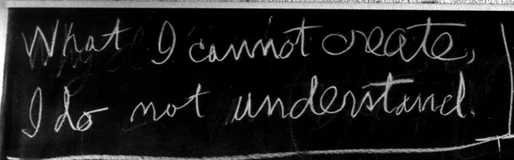

# Git from Scratch

A learning project to build a basic version of Git from scratch and understand how version control works under the hood. The goal is to explore how Git stores objects, tracks changes, and manages commits and branches by implementing the core ideas step by step.

## Motivation

> What I cannot create, I do not understand.

